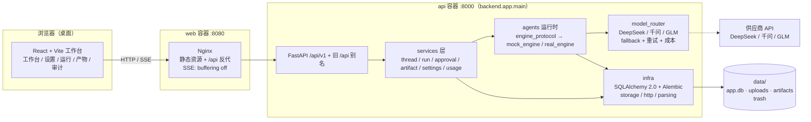

# office-agent-mvp

> **V2.1 标准骨架**：从 V2.0 毛胚升级为「可日常自用、可持续演进」的办公 Agent 工作台。
> 分层架构 + 契约快照 + 真实模型（DeepSeek 默认，千问/GLM 可切换 + fallback）+ 30 条 smoke + CI 六门禁。
> 默认 mock 模式：无 Key、断网也能完整演示。

[](CHANGELOG.md)
[](tests/README.md)
[](docs/acceptance.md)
[](contracts/README.md)

## 目录

- [这个项目是什么](#这个项目是什么)
- [架构](#架构)
- [目录结构](#目录结构)
- [快速开始（10 分钟）](#快速开始10-分钟)
- [给别人一台电脑用：打包成一个 exe](#给别人一台电脑用打包成一个-exe)
- [模型配置（DeepSeek / 千问 / GLM / WorkBuddy）](#模型配置deepseek--千问--glm--workbuddy)
- [开发命令](#开发命令)
- [测试与质量门禁](#测试与质量门禁)
- [Docker Compose 启动](#docker-compose-启动)
- [mock 模式](#mock-模式)
- [8 分钟 Demo](#8-分钟-demo)
- [扩展点清单（11 项）](#扩展点清单11-项)
- [环境变量](#环境变量)
- [已知问题](#已知问题)
- [贡献与发布](#贡献与发布)
- [文档索引](#文档索引)

## 这个项目是什么

一个**单用户、桌面优先**的办公 Agent 工作台：从上传素材 → 计划 → 工具调用 → 高风险审批 →
产物文件（默认与素材同格式：docx/pdf/xlsx/pptx/txt）→ 审计用量，是一条真实链路。V2.1 在 V2.0 毛胚之上补齐了「标准骨架」：

- **分层**：`backend/app/{api,core,domain,services,agents,tools,infra}`；`frontend/src/{app,features,shared}`。
- **契约可校验**：`contracts/openapi.v1.json`（53 paths / 65 ops）+ `contracts/events.v1.schema.json` 入库，CI diff 锁版本。
- **真实模型**：DeepSeek 默认（OpenAI 兼容），千问/GLM 可切换，fallback 链 + 降级；无 Key 自动 mock。
- **代码执行**：`code.run_python` 在受控目录跑 Python 脚本（`$OA_INPUTS` 读素材、`$OA_OUTPUT_DIR` 写产物），
  执行完自动登记为产物，适合「用 python-docx 改既有文档 / 用 pandas 汇总表格」这类模板做不了的加工；
  高风险，默认走审批，子进程不继承任何 Key。
- **界面**：默认深色背景（浅色可切，顶栏太阳/月亮，选择记在本地）、90% 基准缩放（设置→外观可在 85–100% 微调）、
  自绘圆角下拉（原生 select 的系统弹层无法圆角化）、所有可交互元素都有对比明显的 hover 反馈
  （`--color-surface-hover` / `--color-brand-solid` 两个令牌统一控制，深浅色各一套）。
- **本机存储可访问**：设置 → 数据与路径 显示上传/产物目录的绝对路径，点「打开」直接唤起系统文件管理器
  （`GET /storage/paths` + `POST /storage/reveal`，只允许这两个固定目录）。
- **会话由用户决定**：回到首页会恢复上次打开的会话（`oa:last-thread`），只有点「新建会话」才开始新会话。
- **任务队列**：上一个任务还在跑时照常输入发送——消息排进输入框上方的「N 条任务排队中」卡片，
  当前任务一结束自动接着执行；卡片上可编辑回输入框、可删除，点「停止」会让队列先暂停。
- **可验证的质量**：后端 117 passed / 覆盖率 84.70%（core 88%）；30 条 smoke；Playwright 6 条；CI 六门禁。
- **可交接**：README + CONTRIBUTING + ADR 0001–0005 + `docs/acceptance.md`（DoD 30 条）+ `KNOWN_ISSUES.md`。

## 架构



关键设计（详见 `docs/adr/`）：

1. **分层 + 依赖方向**：`api → services → domain ← infra`；`api` 禁止直接 import `infra`（ADR 0004）。
2. **契约先行**：事件 v1.1 只追加；OpenAPI/事件 Schema 快照入库，CI `contract` 门禁 diff 为空。
3. **模型路由**：`MODEL_FALLBACK_CHAIN=deepseek,qwen,glm,mock`；错误分类 → 重试 1 次 → 切下一家 →
   全失败降级 mock 并标 `degraded`（ADR 0005）。
4. **事件持久化 + 断线重放**：`run_events` 表；`id=seq`；`Last-Event-ID` / `?after=` 回放。
5. **配置分层热更新**：`core/config.py` 唯一来源（env > DB settings > 默认）；设置中心保存即生效。

## 目录结构

```text
office-agent-mvp/
├── backend/
│   ├── pyproject.toml            # 工程根：ruff/mypy/pytest/coverage
│   ├── alembic.ini
│   ├── config/model_prices.yaml  # 供应商价格表（成本估算）
│   ├── app/
│   │   ├── main.py               # create_app() 组合根
│   │   ├── api/{deps.py,v1/}     # 路由（health/threads/files/runs/approvals/artifacts/settings/...）
│   │   ├── core/                 # config/logging/errors/events/security/utils
│   │   ├── domain/               # entities/enums/ports
│   │   ├── services/             # thread/run/approval/artifact/settings/model/template/skill/usage
│   │   ├── agents/               # runtime/engine_protocol/mock_engine/real_engine/model_router
│   │   ├── tools/                # spec/registry/builtin/{file,doc,todo,xlsx}
│   │   ├── subagents/            # spec/registry + 1 实现 + 2 占位
│   │   ├── skills/weekly-report/ # SKILL.md（可启停）
│   │   └── infra/                # db（SQLAlchemy+Alembic）/ storage / http / parsing
│   └── tests/{unit,integration,contract,e2e,evidence}/
├── frontend/
│   ├── src/app/                  # App/router/providers/error-boundary
│   ├── src/features/             # workbench sessions artifacts settings runs audit（含 api/state/components）
│   ├── src/shared/               # ui / lib（sse, api, format）/ types / config / api/generated
│   ├── e2e/smoke.spec.ts         # Playwright 6 条
│   └── src/test/                 # Vitest setup / msw
├── contracts/                    # openapi.v1.json + events.v1.schema.json（入库，CI diff）
├── deploy/                       # nginx.conf.template + snippets / requirements.api.txt + lock / migrations
├── docs/                         # api.md / events.md / demo.md / acceptance.md / adr/0001-0005
├── scripts/                      # export_openapi.py / export.py / make_sample.py / check_commit_msg.py
├── tests/                        # 30 条黑盒 smoke（pytest + httpx）
├── data/                         # 运行时数据（gitignore）
├── .github/workflows/ci.yml      # 六道门禁 + nightly Playwright
├── .editorconfig / .pre-commit-config.yaml
├── CONTRIBUTING.md / CODEOWNERS / CHANGELOG.md / LICENSE
├── Dockerfile.api / Dockerfile.web / docker-compose.yml / .dockerignore
├── .env.example / Makefile / KNOWN_ISSUES.md / README.md
```

## 快速开始（10 分钟）

### 只想用、不改代码：双击启动

**Windows** 双击仓库根目录的 `启动 Office Agent.cmd`；**macOS** 双击 `启动 Office Agent.command`
（第一次若提示「来自身份不明的开发者」，右键 → 打开）。脚本会自己把环境备齐，然后打开浏览器
`http://127.0.0.1:8000`：

| 情况 | 脚本会做什么 |
| --- | --- |
| 第一次启动 | 建 `.venv`、装依赖、构建界面（要几分钟，窗口里有进度） |
| 之后启动 | 直接起服务，几秒钟 |
| 端口被占 | 自动往后找一个（8001、8002…），**实际用的地址会打在窗口里，也写进标题栏** |
| 已经启动过 | 直接打开浏览器，不会起第二个进程 |
| 缺 Python | 说清装哪个版本、勾哪个选项，并按任意键才关窗口（不会一闪就没） |
| 出错 | 打印「卡在哪 / 为什么 / 怎么办」并等你按键，而不是闪退 |

启动脚本不信任 `PATH`：它先找项目自带的 `.venv\Scripts\python.exe`，再找 `py` 启动器、
PATH 里的 `python`（跳过 Microsoft Store 的那个转发存根——它在 PATH 里但跑起来一声不吭
返回 9009，症状就是「双击了没反应」），最后扫 python.org 的默认安装目录。

中文提示放在 `scripts/messages/*.txt`（`type` 打印），批处理本身保持纯 ASCII——cmd.exe
按字节读批处理，行里混中文会把下一行读坏。

#### 黑窗口不能关：它就是程序本身

双击后起来的那个黑窗口不是「安装程序」，是**正在跑的服务本体**：

| 窗口里写的 | 它是什么 | 关掉会怎样 |
| --- | --- | --- |
| 启动完成，可以用了 | 服务本体（uvicorn 跑在这个进程里） | **等于退出程序**，浏览器/桌面图标立刻打不开 |
| 已经在运行，不用再开一个 | 只是个探测窗口，发现服务已在跑，顺手打开浏览器 | 没影响，按任意键或点 ✕ 都行 |

桌面图标（含「安装到本机」装出来的窗口）本质是**浏览器窗口**，指向 `http://127.0.0.1:8000`，
它自己不含服务端：服务在跑，它是完整应用；服务停了，它就是「无法访问此网站」，刷新也没用。

所以：**电脑重启过、或者把黑窗口关了，就要重新双击一次 `启动 Office Agent.cmd`**。
正常使用期间把黑窗口最小化即可，不用管它。

服务真的断了的时候不用猜：界面顶部会自动冒出一条提示——「本机服务已断开」+ 让你去双击
启动器 + 一个「重试」按钮（服务回来后点一下就地恢复，不用刷新页面）。没这条提示说明
服务是活的，你看到的内容还能继续用。

#### 界面还是旧的样子？先对一下构建号

`frontend/dist` 和打包好的 exe 都**不进版本库**（`.gitignore`），`git pull` 只更新源码。
没重新构建就跑，看到的会是上一版界面——底部还挂着早就删掉的卡片、某个区块少了一次改版，
看起来像「样式坏了」，其实是跑的产物旧了。

一眼确认的方法：

- **设置 → 关于 → 前端构建**：形如 `60a4d6a-202610292215`，前半段是构建时的 git 提交；
- 后端 `/api/v1/health` 的 `git_sha` 是服务端所在的提交；
- 两者不一致时，界面顶部会自动冒出一条「这个窗口跑的是旧版界面」，点「刷新」即可。
  （同一份仓库正常构建的情况下两者必然一致，日常不会出现。）

修正办法：

| 你的跑法 | 要做什么 |
| --- | --- |
| `npm run dev`（5188/5173） | 不用管，Vite 直接读源码 |
| 单端口 `SERVE_FRONTEND=1 python -m uvicorn …` | `cd frontend && npm run build`，刷新页面 |
| 双击 `启动 Office Agent.cmd` | 重跑启动脚本（它发现 `dist` 比源码旧会自己重建） |
| `dist/Office Agent.exe` | 重新 `pyinstaller` 打包：exe 里的前端是打包时冻结进去的 |

排错用 `python scripts/launch.py --check`（只体检、不启动）：一眼看出是缺依赖、缺界面产物，
还是端口被占。命令行党也可以 `make start`。

> 这条路径只起**一个**进程：FastAPI 顺带托管 `frontend/dist`（`SERVE_FRONTEND=1`），
> 所以不需要 Node、不需要开两个终端。开发态仍是下面的双进程流程。

### 给别人一台电脑用：打包成一个 exe

不想让对方装 Python 和 Node 时，把它打成一个**单文件 exe**（约 37 MB，双击即用）：

```bash
make exe          # 或：./.venv/Scripts/python.exe -m PyInstaller packaging/office_agent.spec --noconfirm
```

产物是 `dist/Office Agent.exe`。对方双击后的体验和上面的启动脚本一致：起服务、打开浏览器，
关掉黑窗口即退出。

| 关心的事 | 答案 |
| --- | --- |
| 要装 Python / Node 吗 | 都不用，exe 自带运行时和界面文件 |
| 用户数据存在哪 | `%LOCALAPPDATA%\Office Agent`（数据库、上传、产物、`.env` 里的 Key 都在这） |
| 换台电脑还能用吗 | 数据在原来那台机器上；想带走就拷贝上面那个目录 |
| 想指定数据目录 | `Office Agent.exe --data-dir D:\我的数据`；只看路径用 `--show-data-dir` |
| 其它参数 | `--port 8000`、`--no-browser` |

> 打包最关键的一条纪律：**用户数据不能写进 exe 的解压目录**（`--onefile` 每次启动解压、
> 退出即删，写进去的东西第二天就没了）。代码里用 `backend/app/core/paths.py` 把
> 「只读资源根」（前端 dist、提示词、技能、迁移脚本）和「可写数据根」分开，
> `backend/tests/unit/test_paths.py` 把这条不变量钉成了测试。

### 开发：从源码跑（双进程）

前置：**Python 3.13**、**Node.js 20+**。Windows 用 PowerShell/Git Bash 均可。

### 1. 安装依赖

```bat
python -m venv .venv
.venv\Scripts\python.exe -m pip install -i https://mirrors.aliyun.com/pypi/simple -e backend
.venv\Scripts\python.exe -m pip install -i https://mirrors.aliyun.com/pypi/simple pytest pytest-cov httpx python-docx pypdf openpyxl jsonschema
cd frontend && npm ci && cd ..
```

macOS / Linux 用 `.venv/bin/python` 与相同命令；亦可 `make setup`（需 GNU make）。

> **图片识别 / 会议录音转写（可选）**：这两项要多装几百 MB 的模型与推理框架，
> 默认不打进依赖里。需要时加装一个 extra：
>
> ```bat
> .venv\Scripts\python.exe -m pip install -i https://mirrors.aliyun.com/pypi/simple -e "backend[media]"
> ```
>
> 装好后 `/api/v1/health` 的 `media` 字段会报 `ocr: true` / `asr: true`；
> 语音模型（默认 `base`，约 145MB）首次使用才会下载，`ASR_ENDPOINT` 默认走
> `hf-mirror.com` 镜像。没装也不影响文档类功能，只是上传图片/录音时会提示
> 「识别组件未安装」。
>
> **图片识别想更准就上 PaddleOCR**（推荐，中文与小字明显好于 onnx 版）：
>
> ```bat
> .venv\Scripts\python.exe -m pip install -i https://mirrors.aliyun.com/pypi/simple -e "backend[media,ocr-paddle]"
> ```
>
> `OCR_ENGINE=auto`（默认）会优先用 PaddleOCR，没装就临时退回 RapidOCR，
> 所以这两步可以只做一步。Paddle 的模型首次识别时联网下载（几十 MB），
> 之后走本地缓存；要强制某一家就配 `OCR_ENGINE=paddle|rapid`，缺组件时
> 报错信息里带安装命令。当前实际用的是哪家，看 `/api/v1/health` 的
> `media.ocr_engine`。

> **镜像源**：本机实测官方 PyPI 与清华镜像不可达，**阿里云镜像可用**
> （`-i https://mirrors.aliyun.com/pypi/simple`）；npm 使用默认 registry。
> **依赖事实来源**：`backend/pyproject.toml`；`deploy/requirements.api.txt` 仅用于 CI 依赖审计（需与 pyproject 同步）。

### 2. 配置环境变量

```bat
copy .env.example .env
```

默认 `MOCK_MODE=true`：无需任何 Key。**不要把真实 Key 写进仓库**（`.env` 已 gitignore）。

### 3. 启动后端（终端 A，在仓库根）

```bat
.venv\Scripts\python.exe -m uvicorn backend.app.main:app --host 127.0.0.1 --port 8000 --reload
```

> 与 `make api` 完全等价：两者都以**仓库根**为工作目录、模块路径都是 `backend.app.main:app`
> （`backend/` 与 `backend/app/` 都有 `__init__.py`，`cd backend && app.main:app` 也能跑，
> 但为与 Dockerfile `CMD` 保持一致，统一用本节写法）。修改其中一处时请同步另一处。

> **起不来 ①：`AssertionError: SRE module mismatch`**
>
> 症状是敲完上面这条命令，进程立刻退出，堆栈里全是 `E:\lib\...` 这种**不在 `.venv` 里**的路径，
> 最后一行是 `assert _sre.MAGIC == MAGIC`。
>
> 这不是代码问题，是机器上有一条**用户级环境变量 `PYTHONHOME`** 指向了别处（本机是 `E:\`）。
> 它优先级高于 venv 自己的配置，等于把标准库换成了另一个 Python 的，两边版本一对不上就崩在
> `import re`。
>
> ```bat
> set PYTHONHOME=                      :: 临时解：当前窗口清掉再启动
> .venv\Scripts\python.exe -m uvicorn backend.app.main:app --host 127.0.0.1 --port 8000
> ```
>
> 永久解是删掉这条用户变量（`setx PYTHONHOME ""`，或「系统属性 → 环境变量 → 用户变量」里删除），
> 然后**新开一个窗口**。用 `启动开发模式.cmd` / `启动 Office Agent.cmd` 启动不受影响——它们开头
> 就把它清空了（`make` 里也有一份等价的 `unexport`）。
>
> 顺手记一条：这时前端 5173 会刷一堆 `http proxy error: /api/v1/health / ECONNREFUSED`、
> 页面顶部显示「还没连上本地服务」——那只是**后端没起来**的连带反应，不用去查前端的代理配置。

> **起不来 ②：端口被占**：`[Errno 10048] only one usage of each socket address`。
> 说明已经有一个后端在跑（或上一次没关干净），浏览器直接开 <http://127.0.0.1:8000/docs> 能出页面就不用再启。

验证：

```bash
curl -s http://127.0.0.1:8000/api/v1/health
# {"trace_id":"...","status":"ok","mode":"mock",...}
```

接口文档：<http://127.0.0.1:8000/docs>（`APP_ENV=prod` 时自动关闭 `/docs`、`/redoc`、`/openapi.json`）；
契约快照：`contracts/`。

> **安全边界（默认只服务本机）**
>
> - 后端默认跑在 `127.0.0.1`，`docker-compose.yml` 也把端口绑定为 `127.0.0.1:8000` / `127.0.0.1:8080`，
>   **不要改成 `0.0.0.0` 直接暴露到公网**——本服务没有账号体系，任何能访问端口的人都能花你的模型额度、
>   读你的产物文件。
> - 确需跨机访问时，打开可选的 API Token：`.env` 里设 `API_TOKEN=<随机串>`（建议
>   `python -c "import secrets;print(secrets.token_urlsafe(32))"`），然后所有请求带
>   `X-API-Token` 头。默认关闭，关闭时不做任何校验；`/` 与 `/health` 始终放行，
>   `OPTIONS` 预检也放行（否则跨域全挂）。
> - 出站请求（模型 `base_url`、联网类工具）走 `core/net_guard.py`：解析 DNS 后拒私网/回环/链路本地地址，
>   可用 `MODEL_BASE_URL_ALLOWLIST` 收紧到具体域名。
> - 上传做「解压后总大小 / 条目数 / 压缩比 / PDF 页数 / 解析文本长度」五重限制，防压缩炸弹。

### 4. 启动前端（终端 B）

```bash
cd frontend
npm run dev
```

打开 <http://127.0.0.1:5173>：上传素材 → 下达任务 → 计划/工具/审批 → 产物 → 审计用量。

### 5. 生成演示素材（可选但推荐）

```bash
.venv/Scripts/python.exe scripts/make_sample.py
# data/samples/meeting_notes.docx
```

## 模型配置（DeepSeek / 千问 / GLM / WorkBuddy）

| 供应商 | 变量 | 默认模型 | 说明 |
|---|---|---|---|
| **DeepSeek（默认）** | `DEEPSEEK_API_KEY` | `deepseek-chat` | 界面显示为 `deepseek harness`；Base URL `https://api.deepseek.com/v1` |
| 通义千问 DashScope | `DASHSCOPE_API_KEY`（兼容 `QWEN_API_KEY`） | 由 `MODEL_NAME` 决定（如 `qwen-plus`） | OpenAI 兼容模式 |
| 智谱 GLM | `GLM_API_KEY` | 由 `MODEL_NAME` 决定（如 `glm-4`） | `https://open.bigmodel.cn/api/paas/v4` |
| WorkBuddy | `WORKBUDDY_API_KEY` + `WORKBUDDY_BASE_URL` | `workbuddy-chat`（可改） | **没有公共接口地址**，两项都要自己填 |

- WorkBuddy 也可以完全在界面里配：设置 →「可用模型与 Key 状态」→ 该行「填接口」填地址、
  「添加 Key」粘 Key、「测试连接」验证；地址改完即时生效（不用重启）。
- `ENGINE=mock|real|deepagents`（默认 `real`）；`MOCK_MODE=true` 或无 Key 时实际生效 mock，
  并在 `/health` 的 `engine_effective`、事件 `run.started.mode`、前端顶部提示中明示。
- `MODEL_PROVIDER=deepseek` + `MODEL_NAME=deepseek-chat`；`MODEL_FALLBACK_CHAIN=deepseek,qwen,glm,mock`。
- **Key 只存引用**：设置中心/DB 只保存 `env:DEEPSEEK_API_KEY`；`GET /settings`、`GET /models` 不回显明文。
- 切换供应商：改 `.env` 的 `MODEL_PROVIDER`/`MODEL_NAME`/`MODEL_FALLBACK_CHAIN`，或直接在设置中心保存（热生效）。
- 真实模型失败会自动 fallback → 降级 mock，事件带 `degraded=true`，运行不中断。

## 开发命令

优先用 Makefile；**Windows 默认没有 `make`**，用右侧原始命令（或 `choco install make`）。

| 目标 | Make | 原始命令（仓库根） |
|---|---|---|
| 一次装齐 | `make setup` | 见「快速开始」1–4 步 |
| **一键启动（单端口）** | `make start` | `.venv/Scripts/python.exe scripts/launch.py`（不带 `--no-browser` 会自动开浏览器） |
| 环境体检 | — | `.venv/Scripts/python.exe scripts/launch.py --check` |
| 启动后端 | `make api` | `.venv/Scripts/python.exe -m uvicorn backend.app.main:app --host 127.0.0.1 --port 8000 --reload` |
| 启动前端 | `make web` | `cd frontend && npm ci && npm run dev` |
| 后端+前端测试 | `make test` | `cd backend && ../.venv/Scripts/python.exe -m pytest -q`；`cd frontend && npm run test` |
| 覆盖率 | `make coverage` | `cd backend && ../.venv/Scripts/python.exe -m pytest --cov=app --cov-fail-under=70`；`cd frontend && npm run test:coverage` |
| 静态检查 | `make lint` | `cd backend && ruff check . && ruff format --check . && mypy app`；前端 `npm run lint && npm run format:check && npm run typecheck` |
| 契约快照 | `make contract` | `.venv/Scripts/python.exe scripts/export_openapi.py --check`；重新生成用 `scripts/export_openapi.py` |
| **打包成 exe** | `make exe` | `./.venv/Scripts/python.exe -m PyInstaller packaging/office_agent.spec --noconfirm` → `dist/Office Agent.exe` |
| **30 条 smoke** | `make smoke` | 自动起 mock 服务(8004) → `.venv/Scripts/python.exe -m pytest tests -q --base-url=http://127.0.0.1:8004` → 停服务 |
| Playwright 6 条 | `make e2e` | `cd frontend && npx playwright test`（需 5173 + 8000 已启动） |
| 本地六门禁 | `make verify` | `lint + test + contract + smoke + build + security` 汇总 |
| Docker | `make docker` | `docker compose up --build -d` |

**Windows 代理变量**：若 `NO_PROXY` 含 `[::1]`，httpx 会报 `InvalidURL: Invalid port: ':1]'`。
测试进程与 Makefile/CI 已统一设为 `NO_PROXY=localhost,127.0.0.1`；手动执行时：

```bat
set NO_PROXY=localhost,127.0.0.1
```
```bash
export NO_PROXY=localhost,127.0.0.1
```

## 测试与质量门禁

**后端**（`backend/tests`：unit / integration / contract / e2e）：

```bash
cd backend
../.venv/Scripts/python.exe -m pytest -q                          # 117 passed, 1 skipped
../.venv/Scripts/python.exe -m pytest --cov=app --cov-fail-under=70   # 84.70%（core 88%）
```

**30 条黑盒 smoke**（`tests/`，mock 服务 8004）：

```bash
# 方式 1：make smoke（自动起停 mock 服务）
make smoke
# 方式 2：先起 mock 服务再直接跑
MOCK_MODE=true ENGINE=mock DATABASE_URL=sqlite:///data/b5_mock.db \
  UPLOAD_DIR=./data/b5/uploads ARTIFACT_DIR=./data/b5/artifacts \
  .venv/Scripts/python.exe -m uvicorn backend.app.main:app --host 127.0.0.1 --port 8004
.venv/Scripts/python.exe -m pytest tests -q --base-url=http://127.0.0.1:8004
# → 30 passed, 1 skipped（真实模型用例默认跳过）
```

**真实模型 smoke**（1 条，消耗真实 token，默认跳过）：

```bash
RUN_REAL_MODEL_TEST=1 BASE_URL=http://127.0.0.1:8000 \
  .venv/Scripts/python.exe -m pytest tests/test_real_smoke.py -q
```

**前端**：`cd frontend && npm run test`（24 passed）；覆盖率 `npm run test:coverage`（当前 8.54%，未达 60% 目标，见 DoD）。

**Playwright 5 条**（页面可达 / 设置热更新 / 产物筛选预览 / 审计导出；需 8000 + 5173）：

```bash
cd frontend && npx playwright test     # 6 passed
```

**CI 六门禁**（`.github/workflows/ci.yml`）：backend-lint / backend-test（覆盖率 + smoke + 工作区洁净断言）/
frontend-quality / contract（快照 diff + 生成类型一致性）/ build（vite + Docker 条件执行）/ security
（secret/PII + pip-audit + npm audit + bandit）；Playwright 另跑 nightly。

## Docker Compose 启动

前置：Docker Desktop / Engine（compose v2）。

```bash
cp .env.example .env      # 可选
docker compose up --build -d
docker compose ps         # api healthy 后 web 启动
curl -s http://127.0.0.1:8080/api/v1/health
```

- 工作台 <http://127.0.0.1:8080>；api 直连 8000；数据卷 `app-data`（/app/data）。
- `ENGINE=mock`（默认）无需 Key；真实模式在 `.env` 填 Key 并 `ENGINE=real`。
- 当前开发机**未安装 Docker**，镜像未实测（KNOWN_ISSUES #1）；配置已按 `backend.app.main:app` 适配并静态校验。

## mock 模式

`MOCK_MODE=true` 或 `ENGINE=mock` 时：

- 不调用外部模型，由内置确定性引擎产出计划/工具调用/审批/产物文件；SSE 时序与真实模式一致。
- 产物只写本地产物目录，**不对外发送**；审批拒绝时零写入（不产生新文件）。
- 断网可完整演示；CI 与 30 条 smoke 全部基于 mock。

## 8 分钟 Demo

完整时间轴与备用台词见 **[docs/demo.md](docs/demo.md)**（设置热更新 → 上传 → 计划/工具 → 审批拒绝/批准 →
产物中心 → 审计导出 → 可选真实模型）。

## 扩展点清单（11 项）

| # | 扩展点 | 位置 | 验收方式 |
|---|--------|------|----------|
| E1 | 工具 | `backend/app/tools/{spec,registry}.py` + `builtin/` | 现场加 echo 工具，模型可调用 |
| E3 | 子智能体 | `backend/app/subagents/{spec,registry}.py` | 1 实现 + 2 占位、调度可见 |
| E4 | 插件与技能 | `backend/app/skills/*/SKILL.md` + `skills_catalog/*/SKILL.md` + `skill_service` + `tools/registry` | 插件 tab 只读展示运行时注册的工具（`/api/v1/tools`）；技能 tab 一键添加、启停影响提示词（`/api/v1/skills`、`/api/v1/skills/catalog`） |
| E5 | Agent 引擎 | `backend/app/agents/{engine_protocol,mock_engine,real_engine}.py` | 切 mock↔real，事件协议不变 |
| E6 | 模型供应商 | `backend/app/providers/` + `model_router.py` | 新增 Provider 类 + 配置参与 fallback |
| E7 | 事件 | `docs/events.md` + `core/events.py` + `run_events` | v1.1 只追加；Last-Event-ID 回放 |
| E8 | 配置 | `core/config.py` + `services/settings_service.py` | 设置热更新；密钥引用 |
| E9 | 存储 | `infra/db/`（SQLAlchemy+Alembic）+ `domain/ports.py` | SQLite/PG 同迁移链 |
| E10 | 插件 | `backend/app/plugins.py`（entry points） | 示例插件工具自动被发现 |
| E11 | 特性开关 | `FEATURE_FLAGS` + 前端 `shared/config` | 关闭入口消失 |
| E12 | 模板 | `services/template_service.py` + `/templates` | 自定义模板可生成产物 |

## 环境变量

完整模板见 [.env.example](.env.example)。核心变量：

| 变量 | 作用 | 默认值 |
|------|------|--------|
| `ENGINE` | 引擎：`mock / real / deepagents` | `real`（无 Key/mock 时实际 mock） |
| `MOCK_MODE` | 强制 mock（CI/断网演示） | `true` |
| `MODEL_PROVIDER` / `MODEL_NAME` | 供应商与模型 | `deepseek` / `deepseek-chat` |
| `MODEL_FALLBACK_CHAIN` | fallback 顺序 | `deepseek,qwen,glm,mock` |
| `DEEPSEEK_API_KEY` / `DASHSCOPE_API_KEY` / `GLM_API_KEY` | 供应商 Key（只放 .env） | 空 |
| `MODEL_TIMEOUT_SECONDS` / `MODEL_MAX_STEPS` | 超时 / ReAct 步数上限 | `60` / `8` |
| `DATABASE_URL` | SQLite/PostgreSQL 连接串 | `sqlite:///data/app.db` |
| `APPROVAL_RULES` / `APPROVAL_TIMEOUT_SECONDS` | 审批工具 / 超时 | `doc.generate_report,file.delete,code.run_python` / `180` |
| `UPLOAD_DIR` / `ARTIFACT_DIR` | 目录 | `./data/{uploads,artifacts}` |
| `LOG_FORMAT` | `json / text` | `json` |
| `FEATURE_FLAGS` | 特性开关（JSON） | `{}` |

> `.env` 已 gitignore；CI secret scan 只扫 git 跟踪文件并显式排除 `.env*`。

## 已知问题

先读 **[KNOWN_ISSUES.md](KNOWN_ISSUES.md)**（每条含影响+绕过方式）。演示/验收前重点确认：

- 本机无 Docker：镜像未实测；无 GNU make；
- 后端 `uv.lock` 缺失（pyyaml 已由 Lead 补入依赖；clean-install 可启动已验证）；
- 前端覆盖率已闭环（72.05%，DoD 第 13 条达标）；生成类型已与契约快照同步；
- 千问/GLM 未逐一实测（缺 Key；DeepSeek 已多次真实链路复测）；
- Playwright 依赖本机 Chrome（`channel: 'chrome'`）；
- Windows `NO_PROXY=[::1]` 问题（测试/Makefile/CI 已处理）。

## 贡献与发布

- 流程与规范见 [CONTRIBUTING.md](CONTRIBUTING.md)：分支 `feat/xxx`、PR ≤400 行、一人 review、当日合并；
  Conventional Commits（`pre-commit install` 后含 commit-msg 校验，见 `scripts/check_commit_msg.py`）。
- 契约规则：`docs/events.md`/`docs/api.md` **只追加**；改接口必须同 PR 更新 `contracts/` 快照。
- 版本：`v0.2.0`（V2.1），见 [CHANGELOG.md](CHANGELOG.md)；许可证 [LICENSE](LICENSE)（MIT）。

## 文档索引

| 文档 | 内容 |
|------|------|
| **[docs/README.md](docs/README.md)** | **文档总索引：按用途找（活文档 / 快照 / 契约 / ADR 分得清）** |
| **[docs/tech/](docs/tech/README.md)** | **技术文档集（15 篇）：架构 · 后端 · 数据 · 事件 · 前端 · 配置 · 部署 · 开发 · 测试 · 安全成本 · 排障** |
| [docs/api.md](docs/api.md) | API v1 契约（48 paths / 60 ops；旧 /api 兼容） |
| [docs/events.md](docs/events.md) | SSE 事件 v1.1（12 类；重放/心跳/扩展字段） |
| [docs/demo.md](docs/demo.md) | 8 分钟 Demo 脚本 + 演示前检查清单 |
| [docs/acceptance.md](docs/acceptance.md) | DoD 30 条逐条勾选 + 证据 |
| [docs/adr/](docs/adr/) | 架构决策记录 0001–0005 |
| [contracts/README.md](contracts/README.md) | 契约快照生成/校验与变更规则 |
| [tests/README.md](tests/README.md) | 30 条 smoke 与 evals 用例映射 |
| [deploy/migrations/0001_init.sql](deploy/migrations/0001_init.sql) | V2.0 四表 DDL 基线（V2.1 用 Alembic） |

## 团队信息

**由周口师范学院team love团队共同开发**
**团队成员：孙子鹏、敬一搏、韩敬卓**
**邮箱地址：17537902544@163.com**