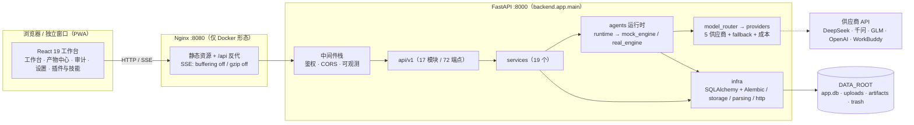
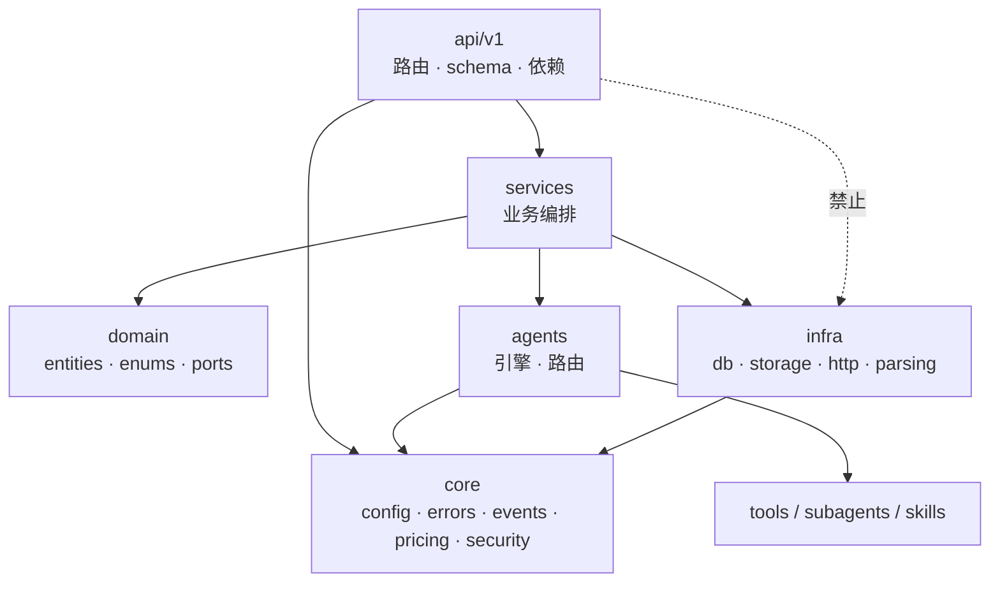
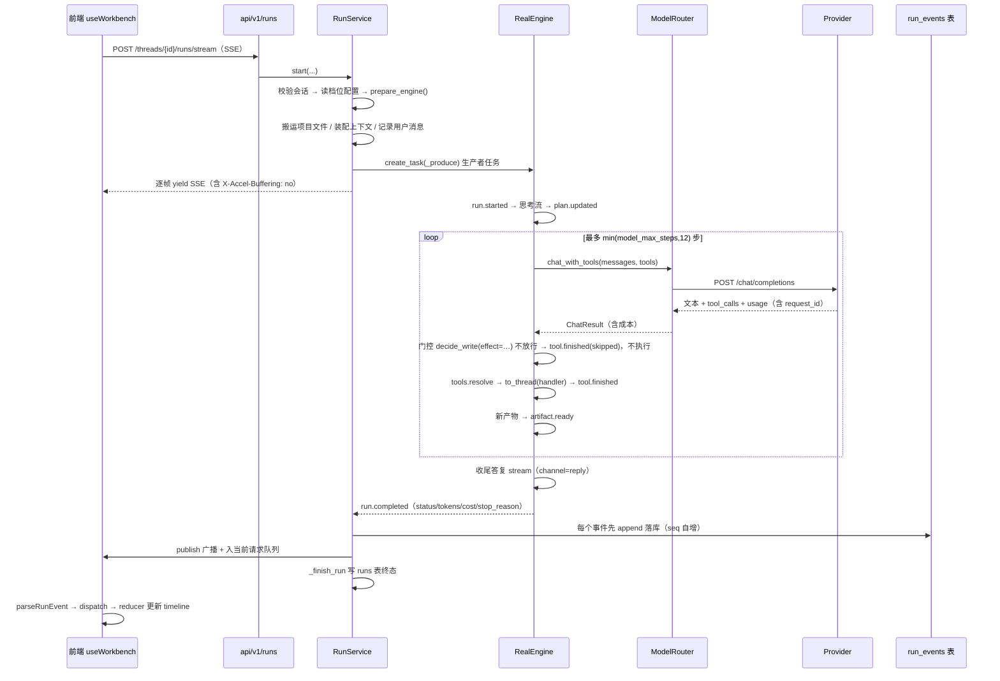

# 02 · 总体架构

> 事实来源：`backend/app/main.py`、`backend/app/api/v1/router.py`、`backend/app/api/deps.py`、
> `backend/app/api/auth.py`、`frontend/eslint.config.js`、`docs/adr/`

## 2.1 全景



四种运行形态（详见 [11 篇](11-deployment-packaging.md)）：

| 形态 | 进程 | 端口 | 用途 |
|---|---|---|---|
| 开发态 | uvicorn + vite 双进程 | 8000 / 5173 | 改代码热更新 |
| Docker Compose | api + web 两容器 | 127.0.0.1:8000 / :8080 | 隔离环境验证 |
| 单端口 | 单个 uvicorn 托管 `frontend/dist`（`SERVE_FRONTEND=1`） | 8000 | 双击启动脚本用 |
| 桌面 exe | PyInstaller onefile，`app_entry.py` 入口 | 自动找空闲端口 | 发给别人用 |

## 2.2 后端分层与依赖方向



规则：

| 规则 | 说明 |
|---|---|
| 依赖方向 | `api → services → domain ← infra`。**`api` 层禁止直接 import `infra`**（ADR 0004），所有数据访问经 service + repository |
| 反向依赖 | `infra` 不认识 `services`；`domain` 只有数据结构与端口（Protocol），不含实现 |
| 注入方式 | 一个 `AppContainer` 数据类持有 15 个组件，端点统一 `Depends(get_container)` |
| 事务边界 | `session_scope()` 短事务，一次业务操作一个会话，api 层不持有 session |

> `api/deps.py` 只有 `get_container` / `ContainerDep`，**没有** `get_db`、也没有 `current_user`。
> 鉴权是全局 ASGI 中间件，不是 FastAPI 依赖——这样才不会缓冲 SSE。

## 2.3 前端分层与边界

由 `eslint-plugin-boundaries` 强制（不只是约定）：

| 层 | 路径 | 可依赖 | 跨层访问规则 |
|---|---|---|---|
| app | `src/app/**` | feature、shared | 应用外壳（路由、Provider、错误边界） |
| feature | `src/features/*` | shared、feature | **只允许通过 `index.ts` 被引用** |
| shared | `src/shared/**` | shared | 设计系统、lib、配置、类型 |
| styles | `src/styles/**` | shared | 仅设计令牌 |
| test | `src/test/**` | 任意 | 测试 setup |

> 无路径别名（`vite.config.ts` 未配 `resolve.alias`），跨 feature 一律走 `index.ts` 桶文件 + 相对路径。

## 2.4 组合根：`create_app()`

`backend/app/main.py` 的 `create_app()` 是唯一装配点，顺序有讲究：

| 步骤 | 内容 | 行号 |
|---|---|---|
| 前置 | `sanitize_no_proxy_env()`（删掉 `NO_PROXY` 里的 IPv6 项，否则 httpx 崩） | `:139` |
| lifespan 启动 | `ensure_dirs()` → `Database` → `auto_migrate` 时跑 `alembic upgrade head` → `build_container()` → `load_plugins()` | `:141-164` |
| lifespan 关闭 | `database.dispose()` | finally |
| FastAPI 构造 | 生产环境关掉 `/docs`、`/redoc`、`/openapi.json` | `:181-183` |
| 中间件 | 先注册鉴权（内层），再注册 CORS（外层） | `:187-195` |
| 可观测 | `@app.middleware("http")` 注入 `trace_id`、记访问日志、给旧 `/api` 加 `Deprecation` 头 | `:197-230` |
| 异常处理 | `register_exception_handlers(app)` | `:232` |
| 路由 | `/api/v1` → 旧别名 `/api` → `/api/v1/openapi.json` | `:233-240` |
| 静态站点 | 有 dist 则 `mount_spa`；**必须排在 `/api` 之后**，否则兜底路由吞掉接口 | `:244-253` |

`build_container()` 装配顺序（`main.py:63-133`）：

```text
8 个 repository → storage / parser / runtime
→ 11 个 service → RunService（注入 12 个依赖）→ AppContainer
→ 装配后三个"让持久化配置立刻生效"的动作：
   settings_service.bind_runtime()  （内部 apply_persisted，含 engine/mock_mode 归一）
   skills.bind_runtime()            （应用技能禁用名单并重建提示词）
   templates.bind_runtime()         （镜像自定义模板到 data/templates.json）
```

## 2.5 中间件栈与挂载顺序

注册顺序 = 调用链**由内到外**（后注册的在外层）：

```text
ApiTokenMiddleware        （最内层，能读到 observability 写入的 trace_id；纯 ASGI，不缓冲 SSE）
  ← CORSMiddleware        （暴露 X-Trace-ID；allow_origins 取自 settings）
    ← observability       （@app.middleware("http")：trace_id + 访问日志 + Deprecation 头）
      ← 异常处理器 + 路由
        /api/v1/*（17 模块 72 端点）
        /api/*    （同一批，include_in_schema=False，响应带 Deprecation + Link 头）
        GET /api/v1/openapi.json
        mount_spa 的 GET /{spa_path:path}（仅 SERVE_FRONTEND 时）
        或 GET /
```

| 中间件 | 关键行为 |
|---|---|
| `ApiTokenMiddleware` | `API_TOKEN` 为空时零开销透传；非空则除 `/`、`/api/v1/health`、`/api/health` 外都要 `X-API-Token`，`hmac.compare_digest` 常量时间比较；`OPTIONS` 预检放行 |
| `CORSMiddleware` | 源来自 `settings.cors_origins`（默认两个 localhost），`allow_credentials=True`，暴露 `X-Trace-ID` |
| observability | 取或生成 `trace_id`；`contextvars` 绑定日志上下文；响应头回写；旧别名加 `Deprecation: true` 与 `Link: </api/v1>; rel="successor-version"` |

## 2.6 一次请求的完整生命周期

以"用户发一句话，生成一份周报"为例：



要点：

| 环节 | 设计 |
|---|---|
| 生产者/消费者 | `asyncio.create_task(_produce)` 是生产者，SSE 生成器是消费者。取消 = 取消生产者 → 生产者落库 `run.cancelled` → 队列收到哨兵结束流 |
| 落库顺序 | **先写 `run_events` 再广播**，保证断线重放一定能拿到 |
| 广播 | `_broker: dict[run_id, set[Queue]]`，多订阅者（并发的续传连接）都能收到；队列满静默丢弃，不拖垮生产者 |
| 心跳 | 长连接空闲/等模型期间每 15s 发 `: ping` 注释帧（**不落库**），防代理/浏览器超时 |
| 断线续传 | 前端带 `Last-Event-ID` 或 `?after=` 重连 → 先回放 `seq > after` 的历史 → 继续订阅新帧，间隔 15s 心跳 |

## 2.7 关键设计取舍（ADR 摘要）

| ADR | 决策 | 理由与现状 |
|---|---|---|
| 0001 | 最小架构：不引入重型框架 | 直接用 FastAPI + SQLAlchemy，避免过度抽象 |
| 0002 | **Mock 优先** | 无 Key / 断网也能完整演示与测试；演示模式是一等功能 |
| 0003 | 自研引擎，不引 deepagents | 引擎协议 `AgentEngine` 留了适配位，`deepagents` 当前 `planned` |
| 0004 | Monorepo + 分层，`api` 禁碰 `infra` | 前端用 `eslint-plugin-boundaries` 同步强制 |
| 0005 | 模型路由：fallback 链 + 重试 + 降级 | 类别 → 策略，见 [06 篇](06-agents-tools-skills.md) |

其他值得知道的取舍：

| 主题 | 取舍 |
|---|---|
| SQLite 默认 | 零运维；已开 WAL + `busy_timeout=5000` + `check_same_thread=False`；列表分页下推 SQL，不做内存切片 |
| 时间存字符串 | 统一 ISO-8601 `String(40)`，便于迁移与跨库，代价是不能直接用数据库时间函数 |
| 扩展字段用 JSON 列 | 8 张表都留 `extra`/`data` JSON，避免频繁迁移 |
| 同步工具放线程 | `await asyncio.to_thread(spec.handler, ...)`，不让阻塞型文件处理卡住事件循环 |
| 成本按现价重算 | 审计读 run 时不直接用当时存的 `cost_cny`，按现价重算，避免改价后历史值失真 |
